# QuoteRight

**Complex quotes. Done right.** A requirements-first prototype for turning a customer RFP into a human-reviewed draft quote.

## Run locally

```sh
cd quoteright
source .venv/bin/activate
python -m streamlit run app.py --server.address 127.0.0.1 --browser.gatherUsageStats false
```

Open http://127.0.0.1:8501. If the agent-started server is already running, use that URL rather than starting another server on the same port.

Run these commands from the downloaded or cloned project folder. On the original development machine, that folder is `/Users/priya/ppagentic/quoteright`.

For a fresh checkout, Python 3.9 or newer:

```sh
python3 -m venv .venv
source .venv/bin/activate
python -m pip install -r requirements.txt
python -m streamlit run app.py --server.address 127.0.0.1 --browser.gatherUsageStats false
```

## Connect Gemini (default) or OpenAI

In the app sidebar, expand **Connection settings**. **Gemini** is selected by default. Create a key in [Google AI Studio](https://aistudio.google.com/apikey) and enter it in **Gemini API key**. The default model is `gemini-3.8-flash`, listed as free-tier eligible by Google when this integration was added. Actual free-tier access, rate limits, and billing depend on your Google project; free-tier content may be used to improve Google products. Use synthetic RFPs. Model availability and pricing can change: [Google pricing](https://ai.google.dev/gemini-api/docs/pricing).

Keys stay in server session memory, never a saved file. Alternatively, set `GEMINI_API_KEY` and optionally `GEMINI_MODEL` in the server environment before launching. To use OpenAI, select **OpenAI** and enter its own key, or set `OPENAI_API_KEY` and optionally `OPENAI_MODEL` (default `gpt-4.1-mini`). The providers have separate credential/model fields; an OpenAI key is never sent to Gemini, and vice versa. Changing provider does not discard a completed analysis; its provider/model provenance remains visible until explicitly analyzed again.

Never put an API key into chat, source control, screenshots, or the learning log. The ignored `.streamlit/secrets.toml` and `.env` files are not loaded by this app.

Analysis is a real call to the selected provider: Gemini's generateContent REST API with a JSON schema, or OpenAI's Responses API with structured outputs. Pressing **Analyze requirements** or **Update analysis** sends extracted text, seller clarifications, and catalog descriptions to that provider. The raw file stays local. OpenAI uses `store=False`; Gemini's provider data-use terms apply. Without a provider-specific key, intake and navigation work, but analysis shows a connection error and does not fabricate a result.

## Four-screen workflow

1. **Customer requirements:** upload PDF, DOCX, or UTF-8 TXT; alternatively paste text. Preview the extracted content. Try the included fictional sample RFP, then analyze.
2. **Review understanding:** inspect needs, must-have/nice-to-have priority, source excerpts, duration, missing information, and product fit. Add clarifications and update the analysis as needed. Confirm understanding.
3. **Review solution:** review suggested products and their rationale, correct quantities/term, adjust products or discount, and acknowledge uncovered requirements. Unknown quantities and unsupported terms require explicit seller input.
4. **Draft quote:** inspect exact itemized prices, approval conditions, customer requirement coverage and remaining gaps. Return to revise the solution.

Sidebar navigation and Back/Continue actions preserve inputs. Changed source text or clarifications invalidate dependent work. Commercial edits invalidate the previous draft. Acknowledgements reset when the set of uncovered needs changes. Suggestions are for human review and do not prove full compatibility.

## Input limits

5 MB and 40,000 extracted characters. Text-based PDFs only; no OCR. DOCX extraction includes paragraphs and tables; headers, footers, embedded images, and complex layout interpretation are not supported. Paragraphs and tables are grouped during extraction, so review context around tables. Oversized, empty, encrypted, unsupported, or malformed inputs are rejected with an actionable message. Seat counts above 10^18 are rejected as outside the prototype's numeric range, rather than allowing currency precision errors. Use synthetic customer data for this prototype. Documents and drafts live only in the browser's server session and are not written to disk.

## System design

```mermaid
flowchart LR
    U[Seller] --> UI[Four-screen Streamlit workflow]
    UI --> DOC[Programmatic PDF/DOCX/TXT extraction]
    DOC --> AI[Gemini or OpenAI: requirements and catalog suggestions]
    AI --> CHECK[Programmatic schema, source excerpt and catalog validation]
    CHECK --> HUMAN[Seller reviews and confirms]
    HUMAN --> PRICE[Deterministic configuration validation and Decimal pricing]
    PRICE --> POLICY[Discount approval rule]
    POLICY --> DRAFT[Reviewable DRAFT quote with coverage gaps]
```



AI interprets and suggests; programmatic code validates and prices. No autonomous agent loop or approval-granting tool is present.

## Verify

```sh
python -m pytest -q
```

Tests use real parsers, pricing functions, and Streamlit AppTest. Provider contract tests exercise Gemini's HTTP adapter and OpenAI's SDK against controlled HTTP transports. Both Analyze-button paths are tested through confirmation and draft calculation. UI fixtures are only in tests; none are included as fallback analysis in the application. Live Gemini analysis has not been verified because no Gemini key was configured during implementation. The user's earlier live OpenAI attempt reached an account quota/rate-limit error.

Acceptance pricing example: for two Team Workspace seats ($20/seat/month), a 12-month term yields $480. A 15% discount yields $408 and approval required. Revising to three seats yields $612 after recalculation. All results stay DRAFT. These numbers are also checked through the four-screen flow with a controlled analysis fixture.

## Files

- `app.py`: application shell, navigation, connection settings, session preservation.
- `screens.py`: intake, understanding, proposed solution, draft review.
- `documents.py`: local, bounded document text extraction.
- `analysis.py`: structured LLM response, request, errors, evidence/catalog validation.
- `gemini_provider.py`: Gemini REST request, structured output, sanitized provider errors.
- `workflow.py`: prerequisites and dependent-state invalidation.
- `catalog.py`: synthetic product loading and search.
- `pricing.py`: authoritative validation, Decimal totals, approval conditions.
- `data/`: five fictional SaaS products, explicit rules, sample RFP.
- `tests/`: parser, provider contract, workflow, UI and commercial-rule scenarios.
- `docs/REQUIREMENTS_WORKFLOW_DESIGN.md`: revised approved architecture and scope.
- `docs/REQUIREMENTS_WORKFLOW_PLAN.md`: implementation checklist.
- `docs/LEARNING_LOG.md`: prompts, changes, verification, reflection questions.
- `docs/DESIGN.md` and `docs/IMPLEMENTATION_PLAN.md`: historical first-build design.

## Commercial boundaries

Line total = monthly price × seats × months. Quote-level discount is rounded once to cents with Decimal ROUND_HALF_UP. Discounts strictly above 10% require approval; exactly 10% does not. Shared 1/12-month term, USD, tax excluded, no duration-based price reduction. Model interpretation is not guaranteed correct: source excerpts are checked for presence, but human review verifies their meaning and the suggested quantities/matches.

No authentication, durable storage, integrations, actual approvals, sending, contracts, or billing. The original Week 1 documents describe the narrower manual prototype; the user explicitly approved the requirements-first scope expansion. GitHub publishing and course recording remain separate work.

API implementation references: [OpenAI structured outputs](https://developers.openai.com/api/docs/guides/structured-outputs), [GPT-4.1 mini](https://developers.openai.com/api/docs/models/gpt-4.1-mini). Parser references: [pypdf text extraction](https://pypdf.readthedocs.io/en/stable/user/extract-text.html), [python-docx](https://python-docx.readthedocs.io/en/latest/user/quickstart.html).

Gemini references: [Structured outputs](https://ai.google.dev/gemini-api/docs/structured-output), [generateContent API](https://ai.google.dev/api/generate-content).
